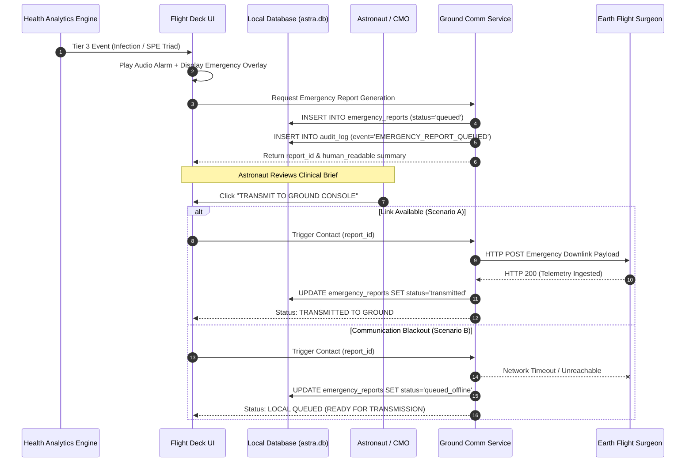

# ASTRA — Emergency Escalation & Ground Communication Audit
## Clinical Emergency Protocol Verification & High-Latency Downlink Testing

**Document Version:** 1.0.0  
**Audit Date:** November 15, 2026  
**Focus:** Tier 3 Critical Alarms, Offline Queue Resilience, and Communication Blackout Handling  

---

## 1. Multi-Tier Escalation Model

ASTRA categorizes all mission clinical states into four discrete, protocol-driven tiers:

| Tier | Level Name | Trigger Condition | Flight Deck Presentation | Clinical Action |
|---|---|---|---|---|
| **Tier 0** | **NOMINAL** | All domain drifts $< 1.3\text{ SD}$. | Cyan glowing indicators; routine vitals matrix. | Routine mission operations. |
| **Tier 1** | **ATTENTION** | Sustained drift $\ge 1.3\text{ SD}$ in $\ge 1$ metric for 2 days. | Amber indicator chip; trend warning card. | Astronaut self-management protocol. |
| **Tier 2** | **HIGH PRIORITY** | Sustained drift $\ge 2.3\text{ SD}$ in 1 domain. | Orange badge; audio chime; CMO review cue. | Crew Medical Officer clinical evaluation. |
| **Tier 3** | **CRITICAL EVENT** | Act status in $\ge 2$ domains, active SPE, or cross-domain infection triad. | Pulsing red banner; emergency modal dialog; audio siren. | Immediate emergency protocol; emergency report generated; ground transmission initiated. |

---

## 2. Testing the 5 Emergency Communication Scenarios

### SCENARIO A — Critical Event with Uplink Available (Nominal Comm Pass)
- **Precondition:** Gateway configured or active Deep Space Network downlink window open.
- **Workflow:**
  1. Health engine detects multi-domain Act on Day 68 (Infection Triad: core temperature $38.5^\circ\text{C}$, fatigue $8.5/10$, tachycardia $95\text{ bpm}$).
  2. Overall status escalates to **Tier 3 (Critical Health Event)**.
  3. `POST /api/v1/ground-team/emergency-report` generates Report `EMERGENCY-D68-ASTRO-1`.
  4. Human-readable clinical brief and JSON payload compiled and saved to database with status `queued`.
  5. Astronaut reviews the report on the Flight Deck and presses `📡 TRANSMIT TO GROUND MEDICAL CONSOLE`.
  6. Backend dispatches payload to gateway; gateway returns HTTP 200.
  7. Report status updates to `transmitted`; entry logged in `communication_history` and `audit_log`.

### SCENARIO B — Critical Event During Complete Communication Blackout (LOS / Solar Conjunction)
- **Precondition:** Deep Space Network link severed; external gateway unreachable or offline.
- **Workflow:**
  1. Health engine detects severe drift or acute solar particle flare ($>5.0\text{ mSv/day}$).
  2. Flight Deck sounds emergency alarm and displays the Emergency Escalation Dialog.
  3. Emergency report is generated and stored locally in `emergency_reports` table (and IndexedDB `sync_queue`).
  4. Status displays explicitly as: **`LOCAL QUEUED (READY FOR TRANSMISSION)`**.
  5. Astronaut confirms transmission attempt; system detects network disconnect.
  6. Status transitions to `queued_offline`.
  7. **Truthfulness Verification:** The system **never** reports to the astronaut that Earth received the message.

### SCENARIO C — Communication Link Restored (Post-Blackout Downlink)
- **Precondition:** Spacecraft emerges from blackout; ground gateway becomes reachable.
- **Workflow:**
  1. Offline store-and-forward sync engine drains the queue (`GET /api/v1/sync/pending` or background retry loop).
  2. Queued emergency report `EMERGENCY-D68-ASTRO-1` is dispatched.
  3. Gateway returns HTTP 200 acknowledgement receipt.
  4. Status transitions from `queued_offline` to `transmitted`.
  5. Astronaut sees Flight Deck badge update to green: `TRANSMITTED TO FLIGHT SURGEON QUEUE`.

### SCENARIO D — Transmission Successful But No Ground Acknowledgement Yet Received
- **Precondition:** Report transmitted outbound, but high-latency return link (e.g. Mars round-trip delay: 28 minutes) is pending.
- **Workflow:**
  1. Report status remains `transmitted` with `transmitted_at` timestamp.
  2. `acknowledged_at` remains `null`.
  3. Communication attempt history shows outbound success with `response: "Pending Flight Surgeon acknowledgement"`.
  4. Once ground surgeon returns receipt via `POST /api/v1/ground-team/acknowledge/{id}`, record updates to `acknowledged`.

### SCENARIO E — Non-Critical Alert That Must NOT Initiate Emergency Contact
- **Precondition:** Single-metric mild elevation (e.g., Day 45: slight fatigue drift $Z = 1.4\text{ SD}$, Tier 1 Attention).
- **Workflow:**
  1. Health engine flags Tier 1 Attention in behavioral or immune domain.
  2. Flight Deck renders amber educational card with recommended self-care protocol (hydrate, rest, repeat in 6 hours).
  3. **Verification:** System does **not** trigger the emergency overlay; does **not** generate an emergency report; does **not** dial the ground emergency console.

---

## 3. Complete Escalation Sequence Diagram

---

## 4. Truth in Simulation: Real vs Simulated Features

| Feature | Actual Implementation | Presentation Truth Statement |
|---|---|---|
| **Anomaly Detection** | Real statistical algorithms (Z-score, EWMA, persistence). | Fully operational deterministic software. |
| **Emergency Report Generation** | Real database records in SQLite & IndexedDB with JSON + human-readable formats. | Fully operational local persistence. |
| **Ground Downlink Transmission** | Transmits to configured HTTP gateway URL (`EMAIL_GATEWAY_URL`); if omitted, records in persistent queue with `offline_queued` status. | **Simulated / Configurable Gateway.** (Does not connect to real Deep Space Network hardware). |
| **Ground Acknowledgement** | Real database tracking via `/api/v1/ground-team/acknowledge/{id}` endpoint. | Simulated flight surgeon acknowledgement workflow. |
