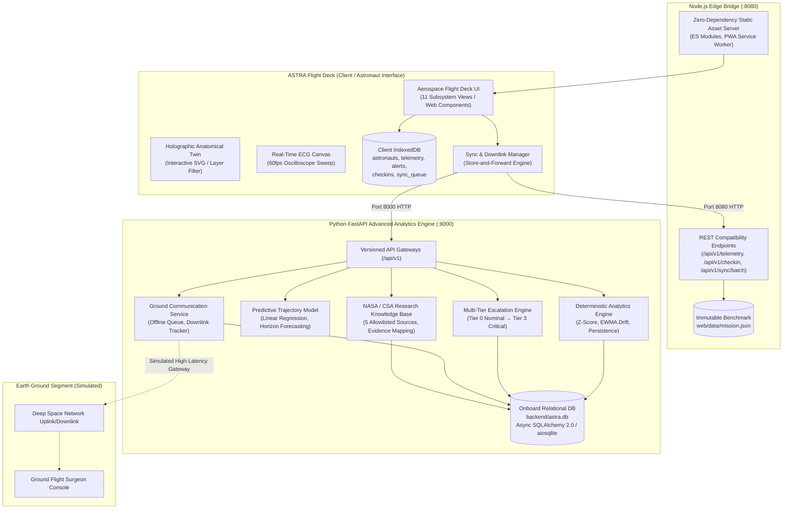
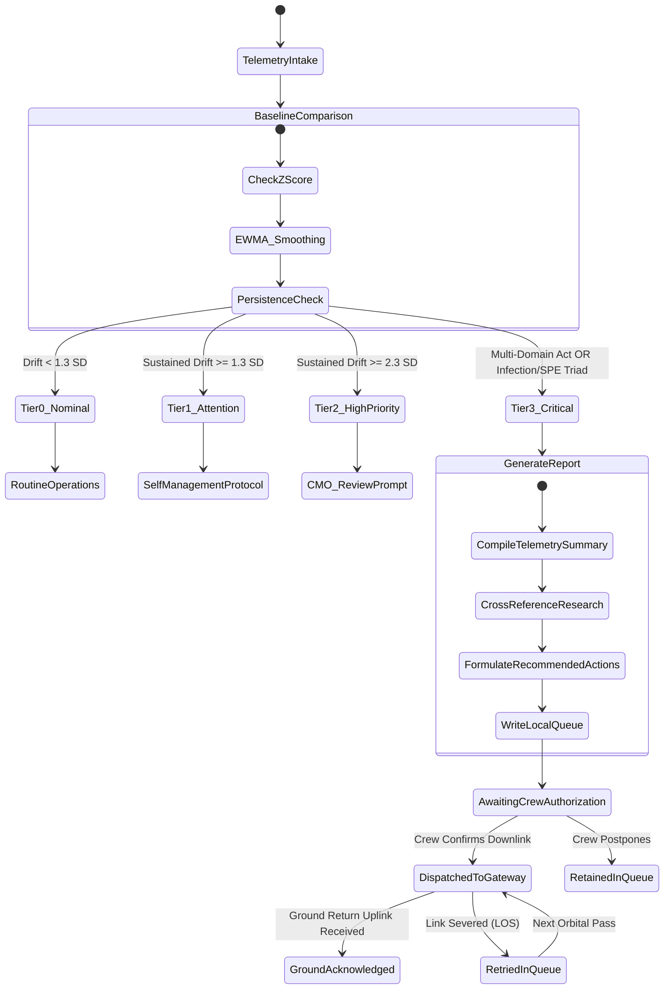
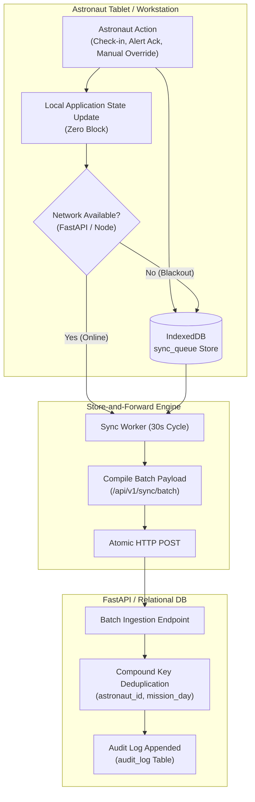

# ASTRA — Complete System Architecture Specification
## Deep Space Astronaut Health Intelligence System

**Document Version:** 1.0.0  
**Project:** ASTRA – Astronaut Health Intelligence System (NASA Space Apps Challenge)  
**Classification:** Technical Architecture Specification & Presentation Audit  
**Date:** November 15, 2026  

---

## 1. Architectural Philosophy & Dual-Server Topology

ASTRA is architected specifically for autonomous, long-duration human deep space missions (such as Mars Transit and Lunar Surface Sorties). The system operates under extreme operational constraints:
- **Variable Signal Propagation Delays:** 3 to 22 minutes one-way radio latency (LOS: Loss of Signal).
- **Communication Blackouts:** Solar conjunctions or planetary occultations resulting in multi-day zero-downlink periods.
- **Resource Constraints:** Zero dependency on remote cloud infrastructure; all computational analysis occurs entirely at the edge.

To balance instantaneous bedside responsiveness with deep computational intelligence, ASTRA implements a **Dual-Server Topology**:

---

## 2. Telemetry Processing & Analytical Pipeline

Information flows from raw biometric measurement through multi-stage statistical filtering to clinical action:

```mermaid
sequenceDiagram
    autonumber
    participant Bio as Astronaut / Sensors
    participant Client as Flight Deck UI (Browser)
    participant Engine as Health Analytics Engine
    participant DB as Local Persistent Store (IndexedDB / SQLite)
    participant Esc as Escalation & Rules Engine
    participant Ground as Ground Medical Queue

    Bio->>Client: Daily Telemetry Logged (17 Clinical Metrics)
    Client->>DB: Commit to Local Storage (Zero Latency)
    Client->>Engine: Trigger prepare(series) & analyze(ctx, day)
    
    rect rgb(20, 35, 55)
        Note over Engine: Baseline Calibration (Days 8-30 Mean & SD)
        Note over Engine: Directional Z-Score Calculation ([-6, +6])
        Note over Engine: EWMA Drift Integration (Lambda = 0.3)
        Note over Engine: Persistence Filter (2 Consecutive Days)
    end
    
    Engine->>Esc: Evaluate Synergy Rules (Infection, CO2, SPE, Bone Loading)
    
    alt Status == Normal (0) or Watch (1)
        Esc->>Client: Render Nominal / Attention Visual Cues (Tier 0 or 1)
    else Status == Act (2) or Cross-Domain Synergy
        Esc->>DB: Log High-Priority / Critical Alert (Tier 2 or 3)
        Esc->>Client: Trigger Emergency Visual Overlay & Chime
        Client->>Ground: Stage Emergency Escalation Report (Status: QUEUED)
        Note over Client: Awaiting Astronaut Authorization to Downlink
    end
```

---

## 3. NASA & CSA Research Integration Architecture

ASTRA connects real-time telemetry anomalies to official published literature from the NASA Human Research Program (HRP) and the Canadian Space Agency (CSA):

```mermaid
flowchart LR
    subgraph Sources ["5 Approved Allowlisted Sources"]
        S1["NASA HRP Hazards<br/>nasa.gov/hrp/hazards"]
        S2["NASA HRP Risks<br/>nasa.gov/hrp/risks"]
        S3["NASA Ongoing HRP Research<br/>nasa.gov/hrp/ongoing-hrp-research"]
        S4["CSA Radiation Monitoring<br/>asc-csa.gc.ca/eng/news/..."]
        S5["CSA Space Science Experiments<br/>asc-csa.gc.ca/eng/iss/science/..."]
    end

    subgraph Pipeline ["Research Processing Pipeline"]
        Fetch["HTTPX Ingestion Engine<br/>(30s Timeout, Allowlist Enforced)"]
        Parser["BeautifulSoup4 Sanitizer<br/>(DOM Stripping, Safe Text Extraction)"]
        Hasher["SHA-256 Hash Verifier<br/>(Integrity & Change Detection)"]
        Classifier["Domain Evidence Mapper<br/>(imm, msk, car, beh, env, rad)"]
    end

    subgraph Storage ["Research Knowledge Base"]
        KB_Relational[("SQLite Knowledge Store<br/>research_sources<br/>research_findings<br/>research_mappings")]
    end

    subgraph Presentation ["Clinical Decision Support"]
        AlertLink["Alert Context Linking<br/>(e.g. Rad Tier 2 → EVARM/MOSFET Dosimetry)"]
        EduModal["Educational Modal & Ground Export Attribution"]
    end

    Sources --> Fetch
    Fetch --> Parser
    Parser --> Hasher
    Hasher --> Classifier
    Classifier --> KB_Relational
    KB_Relational --> AlertLink
    AlertLink --> EduModal
```

---

## 4. Emergency Escalation & Downlink Workflow

---

## 5. Offline-First Synchronization Architecture

